  

<h1 align="center">Fauzan Putra Sanjaya</h1>

  <b>AI Solutions Engineer</b>
   
  Building LLM agents, RAG pipelines, and scalable mobile &amp; web systems.
   
  Information Systems, Universitas Indonesia &nbsp;|&nbsp; Depok, Indonesia

  
  
  

---

## About

I'm an Information Systems student at Universitas Indonesia with a foundation in fullstack development and a growing specialization in AI engineering. I have led engineering teams to deliver scalable applications, and I'm eager to bridge robust software architecture with modern AI.

## Selected projects

  
  

  
  

  
  

Also: <b>Saka</b>, a BIMA-funded mental health app · <b>Almanac</b>, a quant crypto futures system · <a href="https://github.com/dunnowhoo/socialmedia-stance-analysis"><b>Stance Analysis</b></a>, IndoBERTweet at 85.9% · <a href="https://github.com/dunnowhoo/image-inpainting"><b>Emoji Inpainting</b></a>, Pix2Pix GAN · Code for DKE: <a href="https://github.com/dunnowhoo/dke-fe">frontend</a>, <a href="https://github.com/dunnowhoo/dke-be">backend</a> · QRypto: <a href="https://github.com/dunnowhoo/qrypto-app">code</a>

## Tech stack

  

## GitHub stats

  

